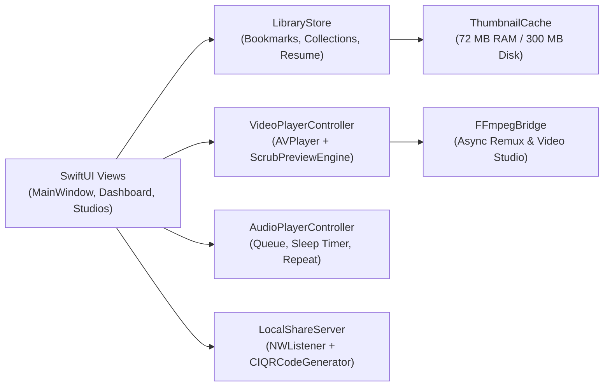

# ChronoStream

**Native macOS Unified Media & Studio Suite for Apple Silicon**


-008080)


ChronoStream is a fast, offline-first native Swift 6 / SwiftUI macOS application built around Apple's Human Interface Guidelines. It unifies long-duration video playback (12–24+ hour DVR & lecture recordings), music playback, photo & video editing, PDF reading, Microsoft Word (`.docx`) authoring, and zero-cloud Wi-Fi QR / AirDrop sharing into a single lightweight app.

---

## Highlights

- **Hardware-Accelerated Video Player**: VideoToolbox decoding via `AVFoundation`, persistent 40-frame pre-warmed real-time seek-bar hover previews, Precision Zoom timeline (`Full` / `1 hr` / `15m` / `2m`), `.srt`/`.vtt` subtitles, resume positions, and full keyboard shortcuts (`Space`, `J`/`K`/`L`, `←`/`→`, `,`/`.`, `0`–`9`, `[`/`]`, `F`, `M`, `Z`, `?`).
- **Broad Container Compatibility**: Magic-byte container inspection automatically plays native `.mp4`/`.mov`/`.m4v` via `AVFoundation` and transparently remuxes Hikvision MPEG-PS, `.mkv`, `.avi`, and `.webm` via an optional Homebrew FFmpeg bridge.
- **Music Player Studio**: Two-column stage with ambient artwork glow, 28-bar live spectrum canvas, 3-state repeat (`Off` / `All` / `One`), `-15s`/`+15s` skip, Sleep Timer, playback speed, and searchable Up Next queue.
- **Doc Writer (`.docx` & PDF)**: Word/Pages-style rich-text studio with native Microsoft Word `.docx` save/open (`officeOpenXML`), Saved Documents library, live-synced formatting ribbon, tables, teaching callouts, code blocks, Teach Mode, and 1-click A4 PDF export.
- **Photo Studio & Video Studio**: Crop, text layers, adjustments, collage & GIF maker, plus FFmpeg-powered trim, crop/rotate/speed, merge, audio replacement, and audio extraction.
- **Cross-Platform Sharing**: Native macOS Share Sheet / AirDrop for Apple devices and an ephemeral, PIN-gated local Wi-Fi QR server (`NWListener` + `CIQRCodeGenerator`) for Android & iPhone browsers with zero cloud servers.
- **Dashboard & Library**: Live library stats, storage breakdown, duplicate detection (128 KB partial SHA-256), Smart & Custom Collections, and Security-Scoped Bookmarks.

---

## Architecture



---

## Installation

### From GitHub Releases
1. Download `ChronoStream-2.0.0-arm64.dmg` (or `.zip`) from the [Releases](../../releases) page.
2. Open the disk image and drag **ChronoStream.app** into `/Applications`.
3. Because this is an unsigned open-source macOS app, **Right-Click → Open** on first launch (or run `xattr -cr /Applications/ChronoStream.app`).
4. *(Optional)* Install FFmpeg for `.mkv`, `.avi`, `.webm`, Hikvision DVR remuxing, and Video Studio operations:
   ```bash
   brew install ffmpeg
   ```

### Verify Checksum
```bash
shasum -a 256 ChronoStream-2.0.0-arm64.dmg
```
Compare the output against `SHA256SUMS.txt` attached to the release.

---

## Building from Source

**Requirements**: macOS 14+, Swift 6.0+ (Xcode or Apple Command Line Tools).

```bash
git clone https://github.com/satyamranatc/ChronoStream.git
cd ChronoStream
swift build -c release
```

To package a signed `.app`, `.dmg`, `.zip`, and `SHA256SUMS.txt` into `dist/`:

```bash
chmod +x scripts/build-release.sh
./scripts/build-release.sh 2.0.0
```

---

## License

MIT License — see [LICENSE](LICENSE).
