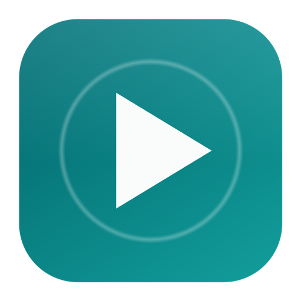
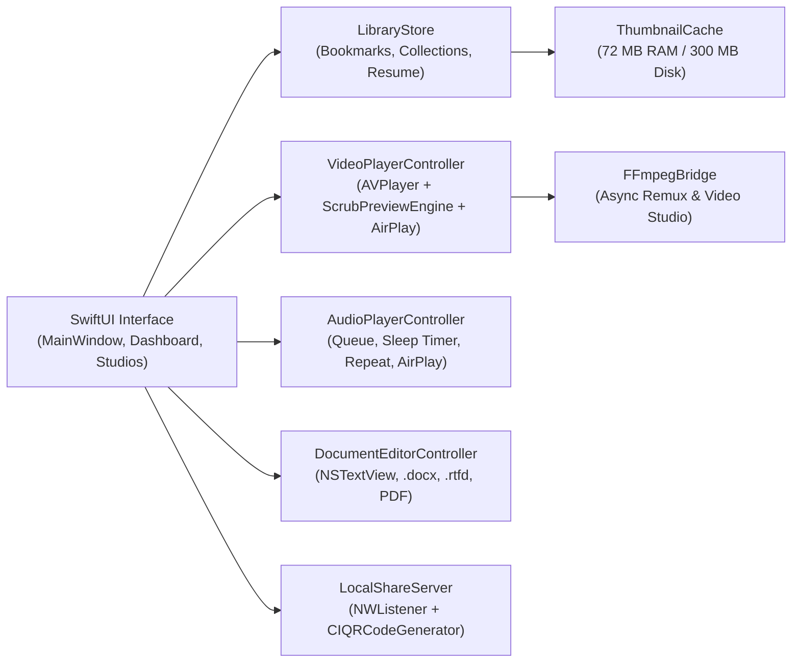

<div align="center">
  

  <h1>ChronoStream</h1>
  <p><strong>Native macOS Unified Media Player, AirPlay Caster &amp; Studio Suite for Apple Silicon</strong></p>

  <p>
    <a href="https://github.com/satyamranatc/ChronoStream/releases/latest">
      
    </a>
    <a href="https://github.com/satyamranatc/ChronoStream/actions/workflows/ci.yml">
      
    </a>
    <a href="https://github.com/satyamranatc/ChronoStream/releases">
      
    </a>
    
    
    <a href="LICENSE">
      
    </a>
  </p>

  <p>
    <a href="https://github.com/satyamranatc/ChronoStream/releases/latest"><strong>Download macOS Installer (.dmg)</strong></a> ·
    <a href="#features">Features</a> ·
    <a href="#keyboard-shortcuts">Shortcuts</a> ·
    <a href="#architecture">Architecture</a> ·
    <a href="#building-from-source">Build from Source</a>
  </p>
</div>

---

## Why ChronoStream?

Most macOS workflows force you to juggle separate apps to scrub **12–24+ hour DVR or lecture videos**, listen to local music, view photos, read PDFs, write Word (`.docx`) notes, and send files to an Android phone. Traditional players stutter when seeking long recordings or reject non-standard containers like **Hikvision MPEG-PS `.mp4`**.

**ChronoStream** solves this in a single, 100% offline-first, **2 MB compiled native Swift 6 / SwiftUI application** built directly on Apple's native frameworks — zero Electron bloat, zero telemetry, zero cloud accounts.

---

## Features

| Module | What It Does |
| :--- | :--- |
| **Hardware Video Player** | `AVFoundation` + VideoToolbox decoding, **0ms pre-warmed real-time seek-bar frame previews**, Precision Zoom timeline (`Full` / `1 hr` / `15m` / `2m`), `.srt`/`.vtt` subtitles, resume positions, and native **AirPlay / Cast** (`AVRoutePickerView`). |
| **Universal Container Bridge** | Magic-byte header inspection plays standard `.mp4`/`.mov`/`.m4v` natively and transparently remuxes **Hikvision MPEG-PS**, `.mkv`, `.avi`, and `.webm` via an optional Homebrew FFmpeg bridge. |
| **Music Player Studio** | Two-column studio layout with ambient artwork glow, 28-bar reactive spectrum canvas, 3-state repeat (`Off`/`All`/`One`), `-15s`/`+15s` skip, Sleep Timer, playback speed, AirPlay audio routing, and searchable Up Next queue. |
| **Doc Writer (`.docx` & PDF)** | Native rich-text word processor with **Microsoft Word `.docx` (`officeOpenXML`)** save/open, Saved Documents panel, live-synced formatting ribbon, native tables, teaching callouts, code blocks, Teach Mode, and A4 PDF export. |
| **Photo & Video Studios** | Non-destructive Photo Editor (crop, movable text layers, adjustments, collage & GIF maker) + FFmpeg Video Studio (trim, crop/rotate/speed, merge, replace audio, extract audio). |
| **AirDrop & Wi-Fi QR Sharing** | Native macOS Share Sheet / AirDrop for Apple devices, plus an ephemeral **PIN-protected local Wi-Fi QR server** (`NWListener` + `CIQRCodeGenerator`) for fast zero-cloud transfers to Android & iPhone browsers. |
| **Library & Dashboard** | Animated Dashboard with storage breakdown, Smart & Custom Collections, fast 128 KB partial SHA-256 duplicate detection, Security-Scoped Bookmarks, and optional Default Video Player registration. |

---

## Keyboard Shortcuts

Press `?` (or click the keyboard icon) anytime inside the Video Player to view the live overlay:

| Shortcut | Action | Shortcut | Action |
| :--- | :--- | :--- | :--- |
| `Space` / `K` | Play / Pause | `[` / `]` | Decrease / Increase Speed (`0.25×`–`4×`) |
| `←` / `→` | Seek `-5s` / `+5s` | `⌫` / `\` | Reset Speed (`1×`) |
| `⇧←` / `⇧→` | Seek `-30s` / `+30s` | `↑` / `↓` | Volume `+10%` / `-10%` |
| `J` / `L` | Seek `-10s` / `+10s` | `M` | Mute / Unmute |
| `,` / `.` | Step Backward / Forward 1 Frame | `F` | Toggle Full Screen |
| `0` – `9` | Jump to `0%` – `90%` | `Z` | Cycle Precision Zoom Window |
| `C` | Load Subtitles (`.srt` / `.vtt`) | `Esc` | Exit Full Screen / Return to Library |

---

## Architecture



---

## Installation

### 1. Download Release (Recommended)
1. Download **`ChronoStream-2.0.0-arm64.dmg`** (or `.zip`) from the [Latest Release](https://github.com/satyamranatc/ChronoStream/releases/latest).
2. Open the `.dmg` and drag **ChronoStream.app** into `/Applications`.
3. **First launch (unsigned open-source app)**: Right-click **ChronoStream.app → Open**, or run:
   ```bash
   xattr -cr /Applications/ChronoStream.app
   ```
4. *(Optional)* Install FFmpeg for `.mkv`, `.avi`, `.webm`, Hikvision DVR remuxing, and Video Studio exports:
   ```bash
   brew install ffmpeg
   ```

### 2. Verify Download Integrity (SHA-256)
Every GitHub Release includes `SHA256SUMS.txt`:
```bash
shasum -a 256 ChronoStream-2.0.0-arm64.dmg
```

---

## Building from Source

**Requirements**: macOS 14+ (Sonoma / Sequoia / Tahoe), Apple Silicon, Swift 6.0+.

```bash
git clone https://github.com/satyamranatc/ChronoStream.git
cd ChronoStream
swift build -c release
```

To package a signed `.app`, `.dmg`, `.zip`, and `SHA256SUMS.txt` into `dist/`:

```bash
chmod +x scripts/build-release.sh
./scripts/build-release.sh 2.0.0
```

---

## FAQ

<details>
<summary><strong>Does ChronoStream send any data to the cloud?</strong></summary>
No. Video playback, library indexing, duplicate detection, document editing, and Wi-Fi QR sharing run 100% locally on your Mac. The optional Dashboard feed fetches public weather (Open-Meteo), Picture of the Day (Wikimedia), and quotes without any user tracking or accounts.
</details>

<details>
<summary><strong>Why do Hikvision DVR .mp4 files fail in QuickTime but work in ChronoStream?</strong></summary>
Many DVR recorders save raw MPEG-PS streams with a <code>.mp4</code> extension. ChronoStream inspects the first magic bytes (<code>00 00 01 BA</code>) and transparently remuxes the container into a clean MP4 in a bounded LRU cache without re-encoding video quality.
</details>

<details>
<summary><strong>Can I open ChronoStream Doc Writer files in Microsoft Word or Google Docs?</strong></summary>
Yes. Doc Writer saves native Microsoft Word <code>.docx</code> files (Office Open XML) by default, alongside <code>.rtfd</code>, <code>.rtf</code>, <code>.html</code>, and A4 <code>.pdf</code> exports.
</details>

---

## Contributing & Security

- Read [CONTRIBUTING.md](CONTRIBUTING.md) for branching, Conventional Commits, and PR verification guidelines.
- See [SECURITY.md](SECURITY.md) for our offline-first security model and vulnerability disclosure policy.
- See [CHANGELOG.md](CHANGELOG.md) for full release history.

---

<div align="center">
  Built by <a href="https://www.satyamrana.in">Satyam Rana</a> · Licensed under the <a href="LICENSE">MIT License</a>
</div>
